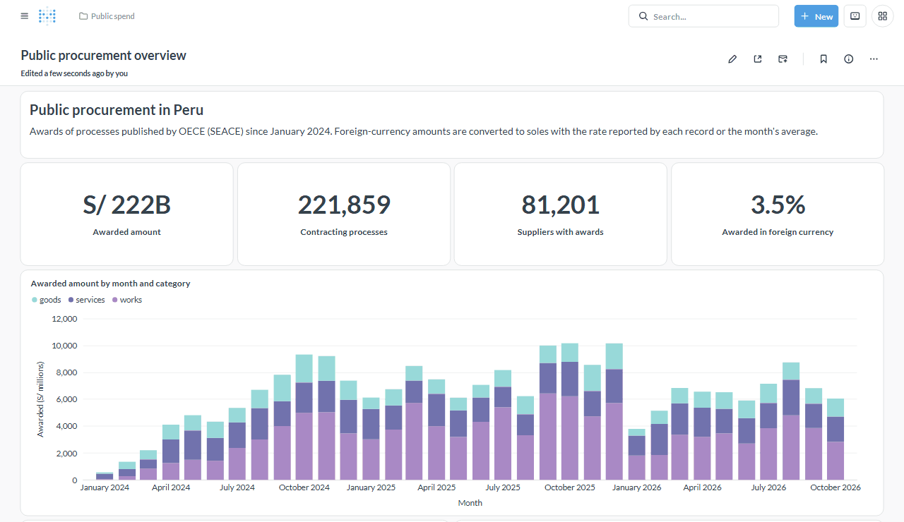
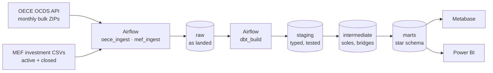
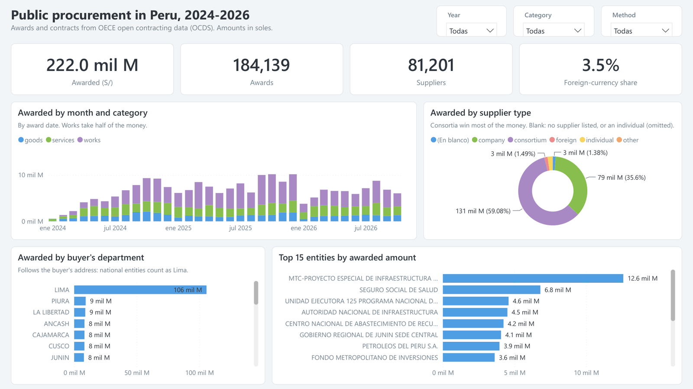
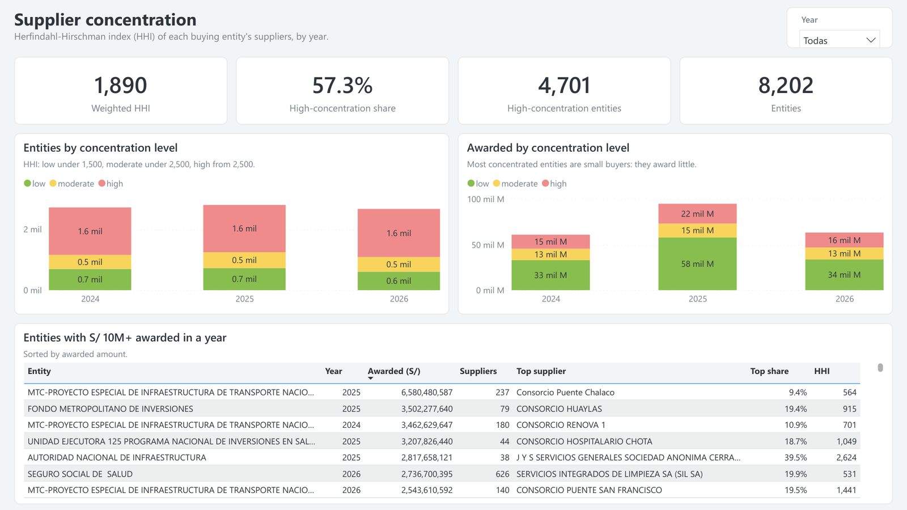
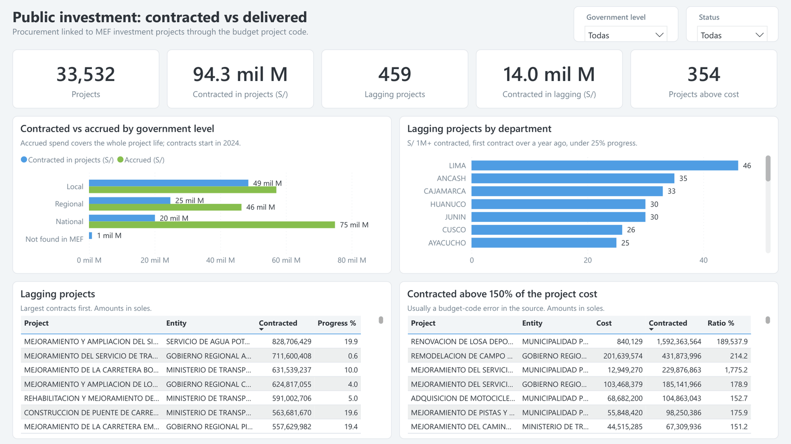

<div align="center">

# Public Spend Pipeline

**Contracted vs. delivered: an end-to-end ELT pipeline that links Peru's public
procurement contracts with the execution of public investment projects.**

[](https://github.com/angelariasus/public-spend-pipeline/actions/workflows/ci.yml)
[](LICENSE)
[](https://www.conventionalcommits.org/)

[](https://www.python.org/)
[](https://airflow.apache.org/)
[](https://www.postgresql.org/)
[](https://www.getdbt.com/)
[](https://docs.docker.com/compose/)
[](https://www.metabase.com/)
[](#power-bi)

[](https://docs.astral.sh/uv/)
[](https://docs.astral.sh/ruff/)
[](https://sqlfluff.com/)
[](https://docs.pytest.org/)
[](https://pre-commit.com/)
[](.github/workflows/ci.yml)



</div>

## Table of contents

- [Overview](#overview)
- [Key findings](#key-findings)
- [Architecture](#architecture)
- [Tech stack](#tech-stack)
- [Data sources](#data-sources)
- [How it works](#how-it-works)
- [Data model](#data-model)
- [Data quality](#data-quality)
- [Dashboards](#dashboards)
- [Getting started](#getting-started)
- [Configuration](#configuration)
- [Development](#development)
- [Project structure](#project-structure)
- [Documentation](#documentation)
- [License and data attribution](#license-and-data-attribution)

## Overview

Peru publishes every public contract in the Open Contracting Data Standard
(OCDS) through OECE, and every public investment project, with its cost,
spend and physical progress, through the Ministry of Economy and Finance
(MEF). The two datasets share a project code but are published separately,
so there is no direct way to see whether the money contracted for a project
turns into delivered works.

This project builds that link. It ingests both sources daily, models them in a
tested star schema and serves dashboards that answer:

1. Which public entities award the most money, and in which categories?
2. How concentrated are each entity's awards among its suppliers?
3. For each investment project, how much was contracted versus what MEF
   reports as spent and physically completed?
4. Which projects have large contracts but little physical progress?
5. How does all of this vary by region, level of government and month?

**Scope:** contracting processes published from January 2024 to October 2026
(34 monthly OECE files) and the full MEF snapshots of active and closed
investments.

## Key findings

| Metric | Detail |
|--------|--------|
| **S/ 222 billion** awarded | 184k awards by 2,992 entities to 81k suppliers; works take 52% of the money |
| **60%** of the amount goes to consortia | with only 22% of the awards; companies win 36% with 59% of the awards |
| **95%** of investment codes matched | 31.8k projects found in MEF, with S/ 93 billion contracted |
| **459** lagging projects | S/ 1M+ contracted over a year ago, under 25% physical progress: S/ 14 billion |
| **354** projects contracted above 150% of cost | mostly tagging errors in the source, e.g. S/ 1.6 billion of works charged to a S/ 0.8 million sports court |

Full analysis in [docs/findings.md](docs/findings.md).

## Architecture



Three Airflow DAGs run the pipeline. `oece_ingest` (09:30 Lima time) and
`mef_ingest` (10:00) load the `raw` schema; each successful load emits a data
asset, and `dbt_build` starts once both assets have been updated (asset-aware
scheduling), checks source freshness and builds every model with its tests.
Metabase and Power BI read the `marts` schema through a read-only role.

Everything runs locally with Docker Compose. The daily run step by step, the
warehouse layers and the full entity-relationship diagram are in
[docs/architecture.md](docs/architecture.md).

## Tech stack

| Layer | Technology | Role |
|-------|------------|------|
| Orchestration | Apache Airflow 3.3 (LocalExecutor) | Daily ingestion DAGs with dynamic task mapping; asset-aware dbt runs |
| Ingestion | Python 3.12, `requests`, `psycopg` 3 | Streaming downloads, content hashing, `COPY` into Postgres |
| Warehouse | PostgreSQL 16 | `raw`, `staging`, `intermediate` and `marts` schemas |
| Transformation | dbt-core 1.12, dbt_utils | 26 models, 97 data tests, source freshness, grants |
| BI | Metabase 0.64 | Two dashboards provisioned as code through the API |
| BI | Power BI | Three-page report on the same marts, with a star schema and DAX measures |
| Infrastructure | Docker Compose | Postgres, Airflow (API server, scheduler, DAG processor), Metabase |
| Quality | pytest, Ruff, SQLFluff, pre-commit | Unit and integration tests, Python and SQL linting, commit hooks |
| CI | GitHub Actions | Lint, `dbt parse`, tests against a Postgres service, Compose validation |

## Data sources

| Source | Content | Access |
|--------|---------|--------|
| [OECE open contracting portal](https://contratacionesabiertas.oece.gob.pe/descargas) | Processes, parties, bidders, items, awards, contracts and exchange rates in OCDS | Paginated file index and one ZIP of CSVs per month; refreshed daily |
| [MEF public investments](https://www.datosabiertos.gob.pe/dataset/informaci%C3%B3n-de-inversiones-p%C3%BAblicas-2001%E2%80%932026-mef) | ~150k active investment projects, 68 columns: cost, accrued spend, physical progress | Single CSV (~250 MB) with `ETag` / `Last-Modified` |
| [MEF closed investments](https://www.datosabiertos.gob.pe/dataset/inversiones-en-estado-cerrado-registradas-en-el-banco-de-inversiones) | ~120k closed projects, 57 columns | Single CSV (~120 MB), disjoint from the active file |

The sources join on the investment project code: OCDS
`planning/budget/projectID` (sometimes a comma-separated list) equals MEF
`CODIGO_UNICO`. The active file alone matched only 77% of the 2024 codes,
because finished projects move to the closed file; with both, 95% match.

## How it works

### Ingestion

**OECE.** `plan_periods` reads the portal's file index and keeps the months in
scope; `load_period` runs once per month as a mapped task, two at a time. Each
task downloads the month's ZIP, hashes the content of the selected CSVs and
skips the month if nothing changed. Otherwise it replaces the month in a
single transaction. Rows land as JSONB documents, because OCDS columns vary
between months.

**MEF.** One mapped task per file sends the stored `ETag` and `Last-Modified`;
a `304 Not Modified` ends the task without downloading. New content is
streamed, validated and loaded with `TRUNCATE` + `COPY` in one transaction.

Both loaders are idempotent and atomic: re-running never duplicates rows, a
failed load keeps the previous data, DDL is serialized with a Postgres
advisory lock, and every load is logged with its hash and row count.

### Transformation

| Layer | Materialization | What it does |
|-------|-----------------|--------------|
| `staging` | indexed tables | One model per source table: English names, defensive casts, source quirks fixed |
| `intermediate` | views | Converts awards and contracts to soles; bridges processes and investment projects; unions active and closed MEF files |
| `marts` | indexed tables | Star schema and analytical marts read by BI tools |

Two transformations carry most of the analytical weight:

- **Currency conversion.** About 2% of awards and contracts are in USD, EUR or
  other currencies. Amounts are converted with the rate reported by the
  record, then the rate of the contract's award, then the month's average for
  the currency; `exchange_rate_source` records which one applied.
- **Process-project bridge.** Comma-separated budget codes are exploded into
  one row per process and project. A process funding several projects (1% of
  them) is split equally, and a test checks that no money is lost or
  duplicated.

The reasoning behind these and other choices, with the alternatives that were
rejected, is in [docs/design-decisions.md](docs/design-decisions.md).

## Data model

| Model | Grain |
|-------|-------|
| `dim_date` | day, 2000–2030 |
| `dim_entity` | buying entity, with its latest name and address |
| `dim_supplier` | supplier, typed as company, individual, consortium or foreign from its tax ID |
| `dim_investment_project` | MEF investment project, active or closed |
| `dim_procurement_process` | contracting process |
| `fct_award` | award, in original currency and soles |
| `fct_contract` | contract, in original currency and soles |
| `mart_investment_vs_procurement` | investment project: tendered, awarded and contracted amounts next to MEF cost, accrued spend and progress, with `is_lagging` and `is_contracted_above_cost` flags |
| `mart_supplier_concentration` | entity × year: supplier count, top-supplier and top-5 shares, Herfindahl-Hirschman Index |

Facts carry single-column surrogate keys (`award_key`, `contract_key`)
because OCDS award and contract IDs are only unique within a process. Every
column is described in the [data dictionary](docs/data-dictionary.md).

## Data quality

- **97 dbt data tests** on every build: key uniqueness, including composite
  keys; referential integrity through a custom `composite_relationships` test;
  accepted values; value ranges; and singular tests, such as checking that the
  active and closed MEF files never share a project code.
- **Source freshness** gates the build: `dbt_build` stops if a raw source is
  older than its threshold.
- **Known source defects are measured, not hidden.** Contracts that reference
  a missing award, truncated tax IDs and progress above 100% are warning-level
  tests that only fail above a threshold.
- **The documentation is checked too.** The data dictionary generator fails
  if any mart column lacks a description.
- **Python is tested** with unit tests (HTTP mocked with `responses`) and
  integration tests that each run in a throwaway Postgres schema.

## Dashboards

### Metabase

Metabase connects as `bi_reader`, a role that can only read `marts`. dbt
grants it access on every build, so rebuilds never break the dashboards.

The dashboards are code. Each question is a SQL file in
`bi/metabase/questions/`, linted in CI, and
`src/public_spend/metabase/content.py` declares the chart type, formatting and
position of every tile. The `metabase-provision` service applies them through
the Metabase API: it completes the first-run setup, connects the warehouse and
creates or updates every question and dashboard by name. Running it again after
an edit updates Metabase in place.

| Dashboard | Answers |
|-----------|---------|
| **Public procurement overview** | Awarded amount by month, category, entity and department; supplier types; supplier concentration per entity and year |
| **Investment projects: contracted vs delivered** | Contracted vs accrued spend by level of government; physical progress; lagging projects; contracts above project cost |

<details>
<summary><b>Public procurement overview</b> (full dashboard)</summary>


</details>

<details>
<summary><b>Investment projects: contracted vs delivered</b> (full dashboard)</summary>


</details>

### Power BI

A three-page report reads the same `marts` schema as `bi_reader`, in import
mode. Dimensions filter the facts through one-to-many relationships, `dim_date`
is the date table, and the numbers come from 22 DAX measures.


The [full video](docs/media/powerbi-demo.mp4) is 54 seconds.

| Page | Answers |
|------|---------|
| **Public procurement** | Awarded amount by month and category, supplier type, buyer's department and top entities |
| **Supplier concentration** | Entities by HHI level, how much each level awards, and the entities awarding S/ 10M or more in a year |
| **Investment** | Contracted vs accrued spend by government level, lagging projects by department, and contracts above 150% of the project cost |

<details>
<summary><b>Public procurement</b> (full page)</summary>



</details>

<details>
<summary><b>Supplier concentration</b> (full page)</summary>



</details>

<details>
<summary><b>Investment: contracted vs delivered</b> (full page)</summary>



</details>

## Getting started

### Prerequisites

- Docker with Docker Compose and about 6 GB of memory for the containers
- [uv](https://docs.astral.sh/uv/), only for local development

### Run the stack

```bash
git clone https://github.com/angelariasus/public-spend-pipeline.git
cd public-spend-pipeline
cp .env.example .env          # replace every change-me value
docker compose up -d --build
```

| Service | URL | Credentials |
|---------|-----|-------------|
| Airflow | <http://localhost:8080> | `AIRFLOW_ADMIN_USER` / `AIRFLOW_ADMIN_PASSWORD` |
| Metabase | <http://localhost:3000> | `METABASE_ADMIN_EMAIL` / `METABASE_ADMIN_PASSWORD` |
| Warehouse | `localhost:5433`, database `warehouse` | `WAREHOUSE_USER` (read-write) or `BI_READER_USER` (read-only) |

### First load

1. In Airflow, unpause `oece_ingest`, `mef_ingest` and `dbt_build`, then
   trigger the two ingestion DAGs. The first OECE load downloads 34 monthly
   files and takes the longest; later runs only reload months that changed.
2. When both finish, `dbt_build` starts on its own and builds the marts.
3. Open Metabase. The dashboards were created by `metabase-provision` and fill
   in once the marts exist.

Loads can also be run from the command line:

```bash
docker compose exec airflow-scheduler python -m public_spend.oece.pipeline --period 2024-01
docker compose exec airflow-scheduler python -m public_spend.mef.pipeline --dataset closed_investments
```

To re-apply the dashboards after editing a question or the layout:

```bash
docker compose up metabase-provision
```

> The Postgres init scripts only run on an empty data volume. On a volume
> created before the BI roles existed, create them once with
> `docker compose exec postgres bash /docker-entrypoint-initdb.d/02-create-bi-roles.sh`.

## Configuration

All settings come from `.env`; [.env.example](.env.example) lists them with
safe placeholders.

| Variable | Purpose |
|----------|---------|
| `POSTGRES_USER`, `POSTGRES_PASSWORD`, `POSTGRES_HOST_PORT` | Postgres superuser and the host port (default `5433`) |
| `WAREHOUSE_DB`, `WAREHOUSE_USER`, `WAREHOUSE_PASSWORD` | Warehouse database and its owner, used by ingestion and dbt |
| `BI_READER_USER`, `BI_READER_PASSWORD` | Read-only role for BI tools |
| `AIRFLOW_ADMIN_USER`, `AIRFLOW_ADMIN_PASSWORD` | Airflow UI login |
| `AIRFLOW_JWT_SECRET`, `AIRFLOW_FERNET_KEY` | Airflow API tokens and encryption of stored connections |
| `METABASE_DB`, `METABASE_DB_USER`, `METABASE_DB_PASSWORD` | Metabase application database |
| `METABASE_ENCRYPTION_KEY` | Encrypts the credentials Metabase stores |
| `METABASE_ADMIN_EMAIL`, `METABASE_ADMIN_PASSWORD` | Admin account created by `metabase-provision` |
| `OECE_START_PERIOD`, `OECE_END_PERIOD` | Months to load (`YYYY-MM`); an empty end means the latest published month |

## Development

```bash
uv sync                       # Python, dbt and tooling
uv run pre-commit install     # lint on commit, Conventional Commits on commit-msg

uv run ruff check . && uv run ruff format --check .
uv run sqlfluff lint dbt/models dbt/tests bi/metabase/questions
uv run pytest                 # integration tests are skipped without a database
```

Integration tests need a Postgres database; each test creates and drops its
own schema:

```bash
TEST_DATABASE_URL=postgresql://warehouse:<password>@localhost:5433/warehouse uv run pytest
```

Run dbt from the host against the local warehouse (dbt does not read `.env`
itself):

```bash
cd dbt
set -a && . ../.env && set +a
export DBT_PROFILES_DIR=.
uv run dbt deps && uv run dbt build
uv run dbt docs generate && uv run dbt docs serve   # lineage graph and docs site
```

After changing a mart or its descriptions, regenerate the data dictionary:

```bash
uv run python -m public_spend.docs.data_dictionary
```

The [CI workflow](.github/workflows/ci.yml) runs on every push and pull request
with four jobs: lint (Ruff and SQLFluff), `dbt parse`, pytest against a
Postgres service, and Docker Compose validation. Commits follow
[Conventional Commits](https://www.conventionalcommits.org/).

## Project structure

```
public-spend-pipeline/
├── airflow/dags/              # oece_ingest, mef_ingest, dbt_build
├── bi/metabase/questions/     # SQL behind every Metabase question
├── dbt/
│   ├── macros/                # defensive casts, OCDS field access, grants
│   ├── models/
│   │   ├── staging/           # one model per source table
│   │   ├── intermediate/      # currency conversion, bridges, unions
│   │   └── marts/             # core star schema + analytics marts
│   └── tests/                 # generic and singular tests
├── docker/                    # Airflow image (with a dbt virtualenv), Postgres init scripts
├── docs/                      # architecture, data dictionary, design decisions, findings, images
├── src/public_spend/
│   ├── oece/                  # index client, ZIP reader, raw loader
│   ├── mef/                   # conditional download, snapshot loader
│   ├── metabase/              # API client, dashboard definitions, provisioning
│   └── docs/                  # data dictionary generator
├── tests/                     # unit and integration tests
└── docker-compose.yml
```

## Documentation

| Document | Content |
|----------|---------|
| [Architecture](docs/architecture.md) | Pipeline diagram, daily run, warehouse layers, star schema |
| [Data dictionary](docs/data-dictionary.md) | Every column of the marts, generated from dbt |
| [Design decisions](docs/design-decisions.md) | Why the pipeline is built this way, and its known limitations |
| [Findings](docs/findings.md) | What the data shows for 2024–2026 |

## License and data attribution

The code is released under the [MIT License](LICENSE).

The data is not part of this repository; the pipeline downloads it from its
publishers:

- Procurement data: **Organismo Especializado para las Contrataciones Públicas
  Eficientes (OECE)**, [Contrataciones Abiertas](https://contratacionesabiertas.oece.gob.pe/),
  published under [CC BY 4.0](https://creativecommons.org/licenses/by/4.0/).
- Investment data: **Ministerio de Economía y Finanzas (MEF)**, Banco de
  Inversiones, published on [Plataforma Nacional de Datos Abiertos](https://www.datosabiertos.gob.pe/)
  under its terms of use.

Figures in this repository are derived from those sources and are not official
statistics of either institution.
