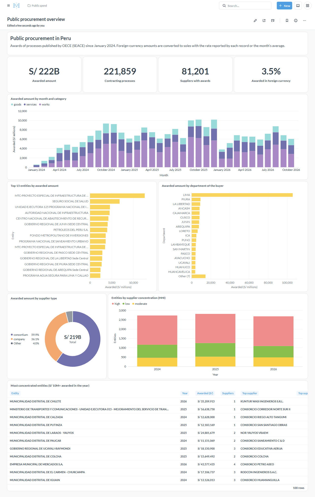
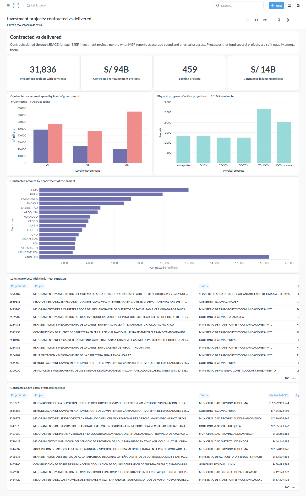

# public-spend-pipeline

An end-to-end ELT pipeline that links Peru's public procurement contracts
(OECE / SEACE, published in the Open Contracting Data Standard) with public
investment execution data from the Ministry of Economy and Finance (MEF), to
measure how much is contracted versus how much is actually delivered.

> Status: ingestion, dbt models, orchestration and Metabase dashboards are
> done. A Power BI report on the same marts is planned.



## Questions this project answers

1. Which public entities award the most money, and in which categories?
2. How concentrated are awards among suppliers, per entity?
3. For each public investment project: how much was contracted versus what
   MEF reports as spent and physically completed?
4. Which projects have large contracted amounts but little progress?
5. How does all of the above vary by region, level of government and month?

## Architecture

```
OECE OCDS API ──┐                                                                       ┌─> Metabase
                ├─> Airflow ─> Postgres `raw` ─> dbt `staging` ─> `intermediate` ─> `marts` ┤
MEF CSVs ───────┘   (Python)   (as landed)       (typed, tested)  (PEN, bridges)   (star)   └─> Power BI (later)
```

Three DAGs run the pipeline: `oece_ingest` and `mef_ingest` load `raw` every
morning, and `dbt_build` starts once both have finished (asset-aware
scheduling).

| Layer          | Tool                                         |
|----------------|----------------------------------------------|
| Orchestration  | Apache Airflow 3.3 (LocalExecutor)           |
| Ingestion      | Python (`requests`, `psycopg`)               |
| Warehouse      | PostgreSQL 16                                |
| Transformation | dbt-core 1.12 + dbt_utils                    |
| BI             | Metabase 0.64 (dashboards as code), Power BI (later) |
| Tooling        | uv, ruff, sqlfluff, pytest, pre-commit, GitHub Actions |

## Data sources

| Source | Access | Notes |
|--------|--------|-------|
| [OECE Open Contracting portal](https://contratacionesabiertas.oece.gob.pe/descargas) | `GET /api/v1/files` (paginated index) and `GET /api/v1/file/seace_v3/csv/{year}/{month}/` (ZIP with one CSV per OCDS table) | CC BY 4.0. Refreshed daily. |
| [MEF public investment detail](https://www.datosabiertos.gob.pe/dataset/informaci%C3%B3n-de-inversiones-p%C3%BAblicas-2001%E2%80%932026-mef) | Single CSV (~250 MB, ~150k active projects, 68 columns) | Full snapshot. Supports `ETag` / `Last-Modified`. |
| [MEF closed investments](https://www.datosabiertos.gob.pe/dataset/inversiones-en-estado-cerrado-registradas-en-el-banco-de-inversiones) | Single CSV (~120 MB, ~120k closed projects, 57 columns) | Same server and behaviour; disjoint from the active file. |

The sources join on the investment project code: OCDS
`planning/budget/projectID` (sometimes a comma-separated list) equals MEF
`CODIGO_UNICO`. The active-projects file alone matches only 77% of the 2024
project codes, because finished projects move to the closed-investments file;
with both files, 95% of the 2024–2026 codes match.

## OECE ingestion

The `oece_ingest` DAG runs daily at 09:30 Lima time, after the portal
refreshes its files.

1. `plan_periods` reads the whole file index, keeps `seace_v3` months between
   `OECE_START_PERIOD` and `OECE_END_PERIOD`, and creates the raw tables.
2. `load_period` runs once per month (dynamic task mapping, two at a time to
   be gentle with the portal). It downloads the ZIP, hashes the content of the
   selected CSVs and compares it with the last load:
   - unchanged content: the month is skipped;
   - new or changed content: the month is replaced in a single transaction.

Design decisions:

- **Rows land as JSONB documents** in `raw.oece_<table>`, one per CSV row.
  OCDS columns vary from month to month, so this avoids schema migrations at
  load time; dbt staging models select and type the fields they need.
- **Change detection uses a content hash.** The portal regenerates every
  monthly file daily, so neither the index timestamp nor the ZIP checksum it
  publishes says whether the data changed.
- **Loads are idempotent and atomic.** A month is deleted and reinserted in one
  transaction; re-running never duplicates rows and a failed load keeps the
  previous data. Every load is recorded in `raw.oece_load_log`.
- **A browser User-Agent is sent** because the portals answer HTTP 418 to
  generic clients.

Tables loaded by default (configurable with `OECE_TABLES`): `records`,
`com_parties`, `com_ten_items`, `com_ten_ite_additionalclassific`,
`com_ten_tenderers`, `com_awards`, `com_awa_suppliers`,
`com_awa_val_exchangerates`, `com_contracts`, `com_con_val_exchangerates`.
The exchange-rate tables matter: about 2% of awards and contracts are in USD,
EUR or other currencies.

## MEF ingestion

The `mef_ingest` DAG runs daily at 10:00 Lima time with one mapped task per
dataset (`investments` → `raw.mef_investments`, `closed_investments` →
`raw.mef_closed_investments`). Each task:

1. Sends the `ETag` / `Last-Modified` of its previous load; on HTTP 304 it ends
   without downloading anything.
2. Otherwise downloads the CSV, hashing it on the way. If the content hash
   matches the last load, only the stored validators are refreshed.
3. On new content validates the header and replaces its table with
   `TRUNCATE` + `COPY` in one transaction.

Design decisions:

- **Typed text columns, not JSONB.** This is one stable table, so columns are
  created from the CSV header; dbt casts them to proper types.
- **The table is never dropped.** dbt views depend on it, so new source columns
  are added with `ALTER TABLE` and removed ones are left NULL.
- **Every load is appended to `raw.mef_load_log`** with its hash, validators,
  row count and column list.
- **DDL is serialized with a Postgres advisory lock**, because parallel tasks
  running `CREATE ... IF NOT EXISTS` on the same object can fail.

## dbt models

The dbt project lives in `dbt/` and builds into three schemas: `staging`,
`intermediate` and `marts`.

**Staging** has one model per source table. Models rename fields to English
snake_case, cast text to numbers, dates and booleans, and are materialized as
indexed tables because they extract from multi-million-row JSONB tables.

| Model | Grain |
|-------|-------|
| `stg_oece__records` | contracting process (`ocid`) |
| `stg_oece__parties` | organization × process |
| `stg_oece__tenderers` | bidder × process |
| `stg_oece__tender_items` / `stg_oece__tender_item_classifications` | tender item / item × UNSPSC code |
| `stg_oece__awards` / `stg_oece__award_suppliers` / `stg_oece__award_exchange_rates` | award / award × supplier / award |
| `stg_oece__contracts` / `stg_oece__contract_exchange_rates` | contract / contract |
| `stg_mef__investments` / `stg_mef__closed_investments` | investment project |

Data quality is enforced with dbt tests: key uniqueness (including composite
keys, since OCDS `award_id` and `contract_id` repeat across processes),
referential integrity through a custom `composite_relationships` test,
accepted values, value ranges, source freshness, and a check that the active
and closed MEF files never share a project code.

Source quirks handled in staging:

- `tender/value/amount_PEN` is 0 for ~5k tenders already in soles, so
  `tender_amount_pen` uses the original amount for PEN tenders.
- Casts are defensive (`to_numeric`, `to_timestamptz`, ... macros): malformed
  values become NULL instead of failing the build.
- MEF coordinates of `0, 0` become NULL; Spanish yes/no flags become booleans.
- The active MEF file repeats a few projects with a technical file amount of
  0 in one copy; staging keeps the row with the highest amount.
- ~1k contracts reference an award missing from their process, and the source
  truncates a few foreign tax IDs in the parties table; these are warning-level
  tests that only fail above a threshold.
- ~200 active investments report physical progress above 100% (warning).

**Intermediate** models (views) do the cross-table work:

| Model | Purpose |
|-------|---------|
| `int_oece__exchange_rates_monthly` | Average rate to soles per currency and month, from every award and contract that reports one |
| `int_oece__awards_pen` / `int_oece__contracts_pen` | Amounts in soles. Rate chain: reported by the record → reported by the contract's award → month average → currency average; `exchange_rate_source` says which one was used |
| `int_oece__process_projects` | Bridge process × investment project, exploding comma-separated budget codes; amounts are split equally among a process's projects (99% fund one) |
| `int_mef__investments_unioned` | Active and closed MEF investments with their shared columns |

**Marts** (tables) form a star schema plus two analytical marts:

| Model | Grain |
|-------|-------|
| `dim_date` | day (2000–2030) |
| `dim_entity` | buying entity (latest name and address) |
| `dim_supplier` | supplier, typed as company, individual, consortium or foreign from its ID |
| `dim_investment_project` | MEF investment project, active or closed |
| `dim_procurement_process` | contracting process |
| `fct_award` | award, in original currency and soles |
| `fct_contract` | contract, in original currency and soles |
| `mart_investment_vs_procurement` | investment project: tendered, awarded and contracted amounts next to MEF cost, accrued spend and physical progress, with `is_lagging` and `is_contracted_above_cost` flags |
| `mart_supplier_concentration` | entity × year: supplier count, top-supplier and top-5 shares, Herfindahl-Hirschman Index |

Facts carry single-column surrogate keys (`award_key`, `contract_key`) so BI
tools such as Power BI can relate them without composite keys. A singular test
checks that splitting multi-project processes neither loses nor duplicates
money.

What the marts show with the 2024-01 to 2026-10 data:

- S/ 222 billion awarded; 2% of awards and contracts are in foreign currency
  (S/ 7.9 billion after conversion).
- 33.5k investment projects received contracts through SEACE; 95% of them are
  found in the MEF files.
- 459 active projects signed at least S/ 1 million in contracts over a year
  ago and still report less than 25% physical progress (S/ 14 billion).
- 354 projects have contracts above 150% of their cost. Many are tagging
  errors: one entity charged S/ 1.6 billion of works to the code of a
  S/ 0.8 million sports court.

Run it against the local warehouse (dbt does not read `.env` itself):

```bash
cd dbt
set -a && . ../.env && set +a
export DBT_PROFILES_DIR=.
uv run dbt deps
uv run dbt build
uv run dbt source freshness
```

In the stack, the `dbt_build` DAG runs the same commands. dbt is installed in
its own virtualenv inside the Airflow image (its pins would conflict with
Airflow's), and each run copies the read-only `dbt/` mount to a temporary
directory so it never writes into the repository. The ingestion tasks emit the
`raw_oece` and `raw_mef` assets; `dbt_build` emits `marts` for the BI layer.

## Dashboards

Metabase reads only the `marts` schema, through a read-only role
(`BI_READER_USER`). dbt grants that role `SELECT` on every mart it builds and
`USAGE` on the schema in an `on-run-end` hook, so access survives each rebuild.
Power BI will connect with the same role.

The dashboards are code. Each question is a SQL file in
`bi/metabase/questions/`, and `src/public_spend/metabase/content.py` declares
the chart type, formatting and position of every tile. The
`metabase-provision` service applies them through the Metabase API: it
completes the first-run setup, connects the warehouse, and creates or updates
the questions and dashboards by name, archiving questions that were removed.
Re-running it after editing a file updates Metabase in place.

| Dashboard | Answers |
|-----------|---------|
| Public procurement overview | Awarded amount by month, category, entity and department; supplier types; supplier concentration (HHI) per entity and year |
| Investment projects: contracted vs delivered | Contracted vs accrued spend by level of government; physical progress of projects with contracts; lagging projects; contracts above the project cost |



## Getting started

Requirements: Docker with ~6 GB of memory, and [uv](https://docs.astral.sh/uv/)
for local development.

```bash
cp .env.example .env        # then replace every change-me value
docker compose up -d --build
```

- Airflow UI: <http://localhost:8080> (user and password from `.env`)
- Metabase: <http://localhost:3000> (`METABASE_ADMIN_EMAIL` and
  `METABASE_ADMIN_PASSWORD` from `.env`)
- Warehouse: `postgresql://<WAREHOUSE_USER>:<WAREHOUSE_PASSWORD>@localhost:5433/warehouse`

The dashboards are empty until the first `dbt_build` run creates the marts.
To re-apply them after editing a question or the layout:

```bash
docker compose up metabase-provision
```

The Postgres init scripts only run on an empty data volume. On a volume
created before the BI roles existed, create them once with
`docker compose exec postgres bash /docker-entrypoint-initdb.d/02-create-bi-roles.sh`.

Enable the `oece_ingest`, `mef_ingest` and `dbt_build` DAGs in the UI, or run
the loads from the command line:

```bash
docker compose exec airflow-scheduler python -m public_spend.oece.pipeline --period 2024-01
docker compose exec airflow-scheduler python -m public_spend.mef.pipeline  # --dataset closed_investments
```

## Development

```bash
uv sync
uv run pre-commit install
uv run ruff check . && uv run ruff format --check .
uv run sqlfluff lint dbt/models dbt/tests bi/metabase/questions
uv run pytest                 # integration tests are skipped without a database
```

Integration tests need a PostgreSQL database; each test uses a throwaway
schema:

```bash
TEST_DATABASE_URL=postgresql://warehouse:<password>@localhost:5433/warehouse uv run pytest
```

Commits follow [Conventional Commits](https://www.conventionalcommits.org/),
enforced by a `commit-msg` hook.

## Project structure

```
├── airflow/dags/          # Airflow DAGs (thin wrappers around src/)
├── bi/metabase/questions/ # SQL behind every Metabase question
├── dbt/                   # dbt project: macros, staging/intermediate/marts models, tests
├── docker/                # Airflow image and Postgres init scripts
├── docs/images/           # dashboard screenshots
├── src/public_spend/      # Python package: ingestion and Metabase provisioning
│   ├── oece/              # index client, bundle reader, raw loader, entry points
│   ├── mef/               # conditional download, snapshot loader, entry point
│   └── metabase/          # API client, dashboard definitions, provisioning
├── tests/                 # unit and integration tests
└── docker-compose.yml
```
