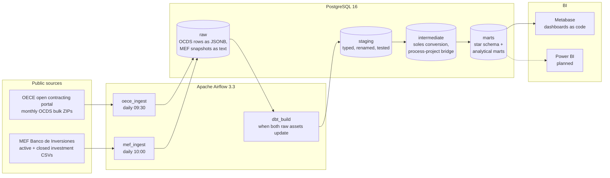
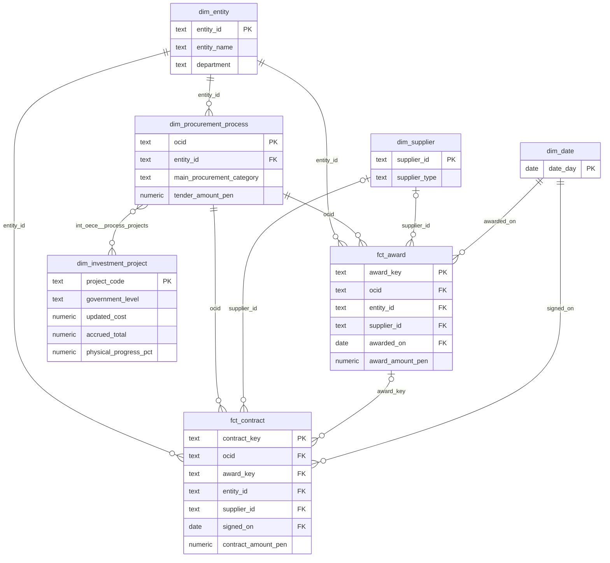

# Architecture

## Pipeline

Everything runs in Docker Compose: one Postgres server hosts the Airflow
metadata database, the warehouse and Metabase's application database. The
Airflow image carries the ingestion package and a separate virtualenv with
dbt.

## Daily run

| Step | DAG / task | What happens |
|------|------------|--------------|
| 1 | `oece_ingest.plan_periods` | Reads the portal's file index, keeps `seace_v3` months in scope, creates the raw tables. |
| 2 | `oece_ingest.load_period` (one mapped task per month, two at a time) | Downloads the month's ZIP, hashes the selected CSVs, skips unchanged months and replaces changed ones in a single transaction. Emits the `raw_oece` asset. |
| 3 | `mef_ingest.load_dataset` (one per MEF file) | Conditional GET with the stored `ETag` / `Last-Modified`; on new content, `TRUNCATE` + `COPY` in one transaction. Emits the `raw_mef` asset. |
| 4 | `dbt_build.source_freshness` | Fails the run if a raw source is older than its threshold. |
| 5 | `dbt_build.build` | `dbt build`: staging, intermediate and marts with their tests, then grants the BI role access. Emits the `marts` asset. |

Steps 1-3 are idempotent: re-running a day never duplicates rows, and a failed
load leaves the previous data in place. The `dbt_build` DAG has no cron
schedule; Airflow starts it once both raw assets have been updated since its
last run.

## Warehouse layers

| Schema | Materialization | Content |
|--------|-----------------|---------|
| `raw` | tables written by Python | One table per OCDS CSV (`oece_*`, one JSONB document per row, keyed by period and row number) and one per MEF file (`mef_*`, text columns from the CSV header). Load logs with hashes and validators. |
| `staging` | tables with indexes | One model per raw table: English snake_case names, typed values, defensive casts, source quirks fixed. |
| `intermediate` | views | Awards and contracts converted to soles; the bridge between processes and investment projects; active and closed MEF investments unioned. |
| `marts` | tables with indexes | The star schema and the two analytical marts read by BI tools. |

## Star schema

Facts carry single-column surrogate keys (`award_key`, `contract_key`)
because OCDS award and contract IDs are only unique within a process.
`mart_investment_vs_procurement` joins the process side with
`dim_investment_project` through the bridge `int_oece__process_projects`, one
row per process and project code; `mart_supplier_concentration` aggregates
`fct_award` per entity and year.

Every column is described in the [data dictionary](data-dictionary.md).

## Code layout

| Path | Role |
|------|------|
| `src/public_spend/oece/` | Index client, ZIP reader, raw loader and CLI for the OECE source. |
| `src/public_spend/mef/` | Conditional download, snapshot loader and CLI for the MEF files. |
| `src/public_spend/metabase/` | API client, dashboard definitions and provisioning. |
| `src/public_spend/docs/` | Data dictionary generator. |
| `airflow/dags/` | Thin DAGs that call the package. |
| `dbt/` | Models, macros, generic and singular tests. |
| `bi/metabase/questions/` | SQL behind every Metabase question. |
| `tests/` | Unit tests (HTTP mocked) and integration tests (throwaway schema per test). |
